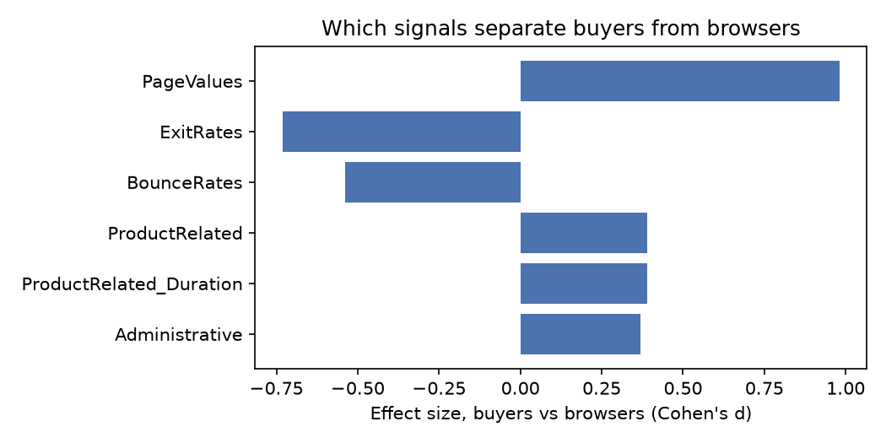
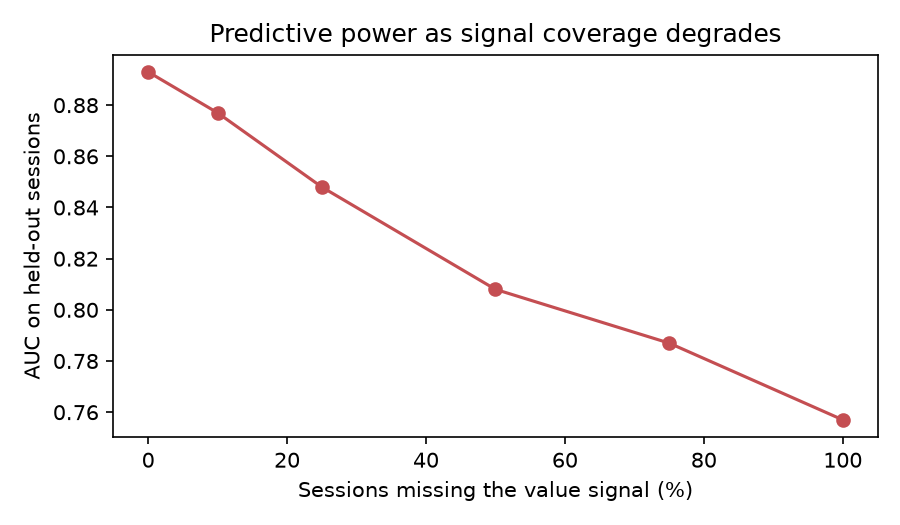

# Ready buyer or casual browser? Research readout

**Question.** Which on-site signals tell us a visitor is ready to buy, and how much predictive power do we lose when a signal goes missing or its coverage degrades?

**Data.** 12,330 e-commerce sessions from the UCI Online Shoppers Purchasing Intention dataset (Sakar et al., 2018, CC BY 4.0). 15.5% of sessions ended in a purchase.

**Methods.**
- Welch t-tests and Mann-Whitney U tests, with Cohen's d as the effect size.
- Chi-square tests of conversion by segment, and a one-way ANOVA.
- Logistic regression with standardised inputs, reported as odds ratios with 95% confidence intervals.
- Signal-group ablation and a coverage-degradation curve, scored by held-out AUC on a 70/30 stratified split.

Reproduce with `src/analysis.py`. The raw numbers are in `results.json`.

## Headline findings

1. **The value signal does most of the work.** PageValues (the value of the pages a visitor saw) is the largest separator between buyers and browsers, with d = 0.98. Holding the other signals constant, a 1 standard-deviation increase multiplies the odds of purchase by **4.4** (95% CI 4.0 to 4.8).
2. **More signals is not more signal.** With the value signal present, removing engagement depth (product pages and time) or the drop-off signals (bounce and exit rates) costs **0.000 AUC**. They are largely redundant with it. Removing the value signal costs **0.136 AUC** (0.893 → 0.757).
3. **Coverage loss is gradual but steep at first.** Blanking the value signal for 10% of sessions costs 0.016 AUC, 25% costs 0.045 and 50% costs 0.085. Half the total loss happens before half the sessions are affected. This is the case for investing in signal coverage, the problem server-side events (for example a conversions API alongside a browser pixel) exist to solve.
4. **New visitors converted more than returning ones**: 24.9% vs 13.9% (χ² = 135, p < .001). The gap holds in the regression (returning visitors' odds ratio 0.71, CI 0.60 to 0.84). This runs against intuition and is the best candidate for qualitative follow-up.
5. **Exit rate is the strongest negative signal** (odds ratio 0.45 per SD). Bounce rate adds nothing once exit rate is in the model (p = .36).

## Caveats (read before quoting)

- **PageValues is partly derived from purchases.** Google Analytics computes page value from transactions that followed those pages. That makes it close to a conversion-value signal, so its predictive strength is partly built in. The ablation should be read as "what a value signal is worth", not as a causal effect of page value.
- The data is observational, from one retailer over one year. The odds ratios describe association, not causation.
- The coverage simulation drops the signal at random. Real signal loss is not random: it clusters by browser, consent choice and device. The next step is to re-run the simulation with loss concentrated in segments.

## Questions for qualitative follow-up (mixed methods)

| Quant finding | Qualitative question | Method |
|---|---|---|
| New visitors convert more | Are new visitors arriving with intent formed elsewhere (ads, search, word of mouth)? What were returning non-buyers doing? | Short intercept survey plus 8 to 10 in-depth interviews, split by new vs returning |
| Engagement adds nothing beyond value | Does long browsing mean comparison shopping or confusion? | Think-aloud usability sessions on the product-page journey |
| Exit rate is the strongest negative signal | Which pages do people leave from, and why? | Exit survey on high-exit pages, then a diary study for considered purchases |
| Coverage loss is steepest early | How do advertisers notice and diagnose missing events today? | Advertiser interviews and a walkthrough of their measurement setup (jobs to be done) |
